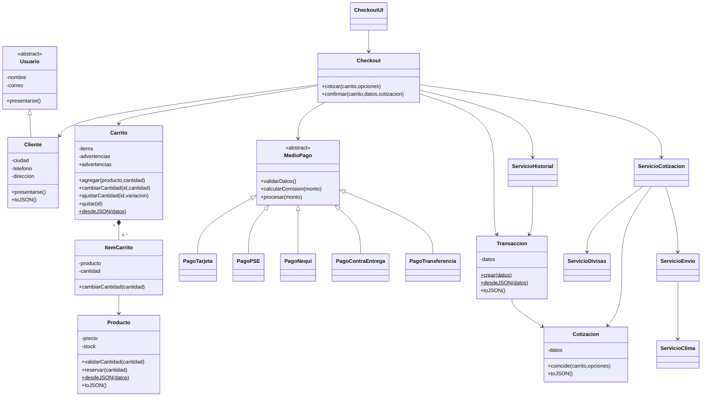
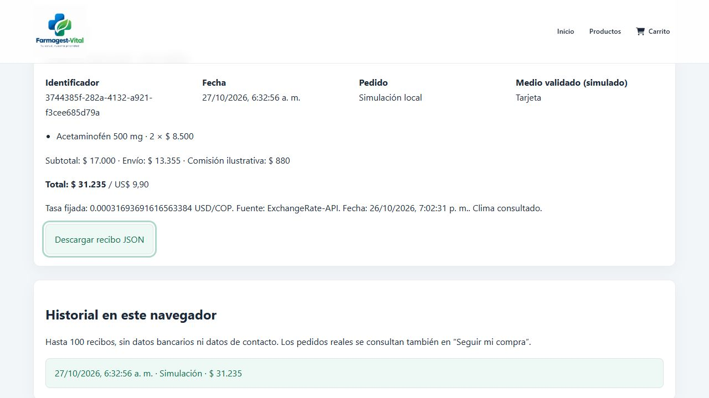
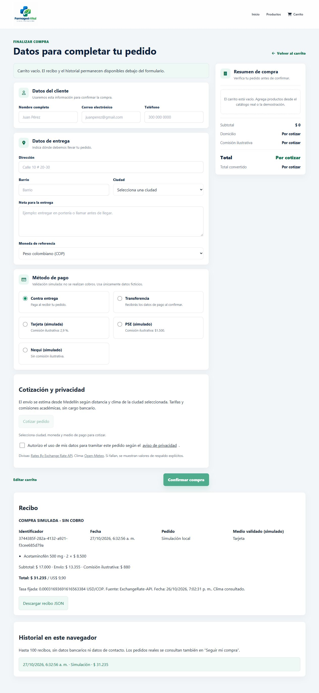

# FarmaGest Vital

Sistema académico de catálogo, pedidos e inventario para farmacia. Frontend con HTML, CSS y JavaScript; API con Express y TypeScript; MySQL o PostgreSQL.

## Ejecutar

1. Usa Node.js 22 o superior y pnpm. Desde la raíz ejecuta `pnpm install`.
2. Copia `.env.example` a `.env` y configura tu base de datos y un `JWT_SECRET` aleatorio. No publiques ese archivo.
3. En local, inicia MySQL desde XAMPP e importa `backends/src/db/db.sql` en una base de desarrollo vacía. En Render, configura `DATABASE_URL` para PostgreSQL; las tablas se inicializan al arrancar. No importes datos de demostración sobre una base de producción.
4. Usa una cuenta administradora existente. En una base nueva, el primer administrador debe crearse en la tabla `users` con la contraseña protegida mediante bcrypt; el registro por API requiere una sesión administradora.
5. Inicia la API con `pnpm start:dev` desde `backends/` (puerto 3000). Sirve el frontend con Live Server o Apache de XAMPP.
6. Abre `index.html` desde ese servidor y accede al panel en `frontends/dashboards/auth/login.html`, bajo la misma URL base.

Los comandos `npm run` solo ejecutan los scripts; las dependencias y el lockfile se gestionan con pnpm. Si ya tienes `backends/.env`, se conserva como configuración de respaldo; las variables cargadas desde el archivo de la raíz tienen prioridad al arrancar el servidor.

## Compra orientada a objetos y simulación académica

El flujo de compra integra los cuatro pilares de POO, un catálogo JSON, cotización de envío según distancia y clima, conversión COP/USD/EUR, validación simulada de Tarjeta/PSE/Nequi y recibos con historial local. [Diagrama UML, requisitos, APIs, créditos y guía de sustentación](docs/poo.md).

Para probarlo sin backend, abre `frontends/ecommerce/products.html?modo=demo` desde Live Server o XAMPP, agrega productos y pulsa **Cotizar pedido** en el checkout. La demostración no genera cobros ni pedidos reales. Las consultas de clima y divisas tienen respaldo cuando no hay conexión.

Los pedidos del catálogo real requieren el backend actualizado: `POST /api/sales/quote` calcula y firma el total; `POST /api/sales/checkout` valida la cotización y el consentimiento antes de registrar el pedido, que queda pendiente de pago. No se envían ni se guardan los datos ficticios del medio de pago.

## Diagrama UML de clases

El diagrama muestra la herencia de usuarios y medios de pago, la composición del carrito y los servicios del checkout. Los atributos privados encapsulan el estado; las clases abstractas definen el contrato de sus implementaciones.

## Autoría y alcance académico

Trabajo individual de **[kleyderBackend](https://github.com/kleyderBackend)**, identidad registrada como autora de los commits del proyecto. El autor confirmó que trabajó solo y tiene aprobación docente para adaptar Coquito Amarillo al dominio de farmacia. No corresponde exigir commits de otros integrantes.

| Responsable | Aportes al proyecto |
| --- | --- |
| kleyderBackend (autor único) | Integración y mantenimiento del frontend, backend, modelo POO, base de datos, documentación, pruebas y publicación. |

Se utilizó asistencia de Codex para cambios de código, revisión, documentación y ejecución de pruebas. Las fuentes externas utilizadas para clima y divisas se atribuyen a continuación. La demostración académica no efectúa cobros.

## APIs y atribución

- Divisas: [Rates By Exchange Rate API](https://www.exchangerate-api.com), con [documentación del acceso abierto](https://www.exchangerate-api.com/docs/free). Las tasas de respaldo se identifican como ilustrativas.
- Clima: [Open-Meteo](https://open-meteo.com/), con [documentación y atribución](https://open-meteo.com/en/docs). Si falla la consulta, se informa el uso del respaldo sin recargo por lluvia.

## Organización del código

Los módulos de inventario y usuarios siguen el patrón existente: archivo de rutas y tipos, carpetas `controllers`, `services` y `repositories`. Las rutas asignan middleware y controladores; los controladores manejan HTTP; los servicios validan y coordinan transacciones; los repositorios ejecutan SQL.

Las pantallas administrativas nuevas reutilizan `dashboard-general.css`, `products-admin.css` y sus componentes de formularios, tablas y mensajes.

## Funciones

- Catálogo, filtros, detalle, carrito, checkout y seguimiento con número de pedido y correo de compra. El seguimiento se consulta mediante POST; el correo no viaja en la URL.
- Productos, categorías, clientes y pedidos. El precio y la disponibilidad se verifican en el servidor.
- Inventario: entradas, salidas y ajustes con motivo y responsable. En un ajuste, la cantidad es el stock final contado. El historial muestra los últimos 500 movimientos; no se eliminan los anteriores de la base.
- Las compras descuentan stock y registran salidas dentro de la misma transacción. Los movimientos de una compra pública llevan responsable nulo y el número de pedido como motivo.
- Una cancelación devuelve stock una sola vez y registra la entrada en la misma transacción. Flujo permitido: pendiente → preparando → en camino → entregado. Los estados anteriores a entrega pueden pasar a cancelado. Entregado y cancelado son finales.
- Alertas de stock mínimo, productos vencidos y vencimientos dentro de 30 días. Un producto que vence hoy puede comprarse; el catálogo excluye vencidos, inactivos y productos sin existencias.
- Usuarios internos: creación, edición, roles, activación y cambio de contraseña. Solo administradores gestionan usuarios; el personal puede operar inventario y pedidos. No se permite desactivar o degradar la propia cuenta ni dejar el sistema sin administrador activo.
- Resumen de productos, pedidos, alertas y valor de pedidos entregados en Reportes.

Al arrancar, la migración de inventario permite un responsable nulo para compras públicas, conservando la clave foránea para las operaciones del personal. Los movimientos anteriores se conservan. Las modificaciones históricas que nunca se registraron no se reconstruyen.

## Verificación

Las capturas de los formularios de acceso y pedido, y de las tablas de MySQL en phpMyAdmin, están en [docs/evidencias/README.md](docs/evidencias/README.md). Incluyen el formulario vacío y diligenciado con datos ficticios, sin enviar compras, y las dos imágenes de la base de datos proporcionadas por el usuario.

### Formulario de acceso

### Formulario de pedido vacío

### Formulario de pedido diligenciado

Datos ficticios de prueba; el pedido no fue enviado.

### Tablas de MySQL

Captura de phpMyAdmin proporcionada por el usuario. Muestra las tablas y su número de filas, sin el contenido de los registros.

### Estructura de la base de datos

Las capturas de la base de datos no demuestran que el formulario mostrado haya guardado esos registros. La evidencia de consola todavía está pendiente.

### Recibo e historial de la simulación POO

Prueba del 27 de octubre de 2026: compra de productos ficticios, cotización con clima y divisas, validación de tarjeta simulada y recuperación del mismo recibo al recargar. No generó cobros ni registros en MySQL.

Vista completa del formulario, recibo e historial:

### Pruebas automatizadas

Se comprobaron 34 pruebas: 18 del backend y 16 del frontend. Incluyen los subtotales y límites de cantidad resueltos en las clases, las confirmaciones obligatorias de contra entrega y transferencia, y la recuperación de carritos con líneas inválidas sin perder los productos válidos.

`npm run typecheck` comprueba TypeScript. `npm test` ejecuta pruebas de inventario, rollback, estados, cancelación repetida y concurrente, checkout, vencimientos, autorización y privacidad del seguimiento.

Las pruebas utilizan un doble transaccional de base de datos y un servidor HTTP temporal; no escriben en la base configurada. En Windows, el entorno debe permitir conexiones a localhost para las pruebas HTTP. Estas pruebas no sustituyen la validación final con MySQL/PostgreSQL.

Para comprobar la instalación con tu base de desarrollo: crea un producto con stock, registra una entrada y un ajuste, realiza una compra desde el catálogo, comprueba su seguimiento con correo correcto e incorrecto, cancela el pedido dos veces y verifica que el stock se reponga una sola vez. Comprueba también que un usuario de personal no pueda administrar usuarios y que una cuenta desactivada pierda acceso.

## Configuración de despliegue

La API local usa el puerto 3000. El puerto del frontend depende de Live Server o Apache de XAMPP. Para otros dominios, configura `CORS_ORIGINS` como una lista de orígenes separados por comas. La URL de API de producción está en `frontends/js/api.js`; puede sobrescribirse mediante `farmagestApiUrl` en el almacenamiento local del navegador.

Para publicar la extensión POO en Render, deja **Root Directory vacío**, instala con `pnpm --dir backends install --frozen-lockfile` e inicia con `npm start` desde la raíz. La API reutiliza clases de `frontends/js/`; publica frontend y backend juntos. [Detalles de despliegue](docs/poo.md#despliegue-del-catálogo-real).

Si una instalación anterior usa la cuenta de demostración, cambia su contraseña desde Usuarios; el arranque ya no la restablece. La limitación de intentos se mantiene en memoria por instancia. No se ha realizado despliegue ni migración de una base remota como parte de estos cambios.

Cobros bancarios reales, proveedores, compras a proveedores y contabilidad quedan fuera del alcance. La extensión académica incorpora validación simulada de medios de pago y cotizaciones, sin pasarela de cobro.
