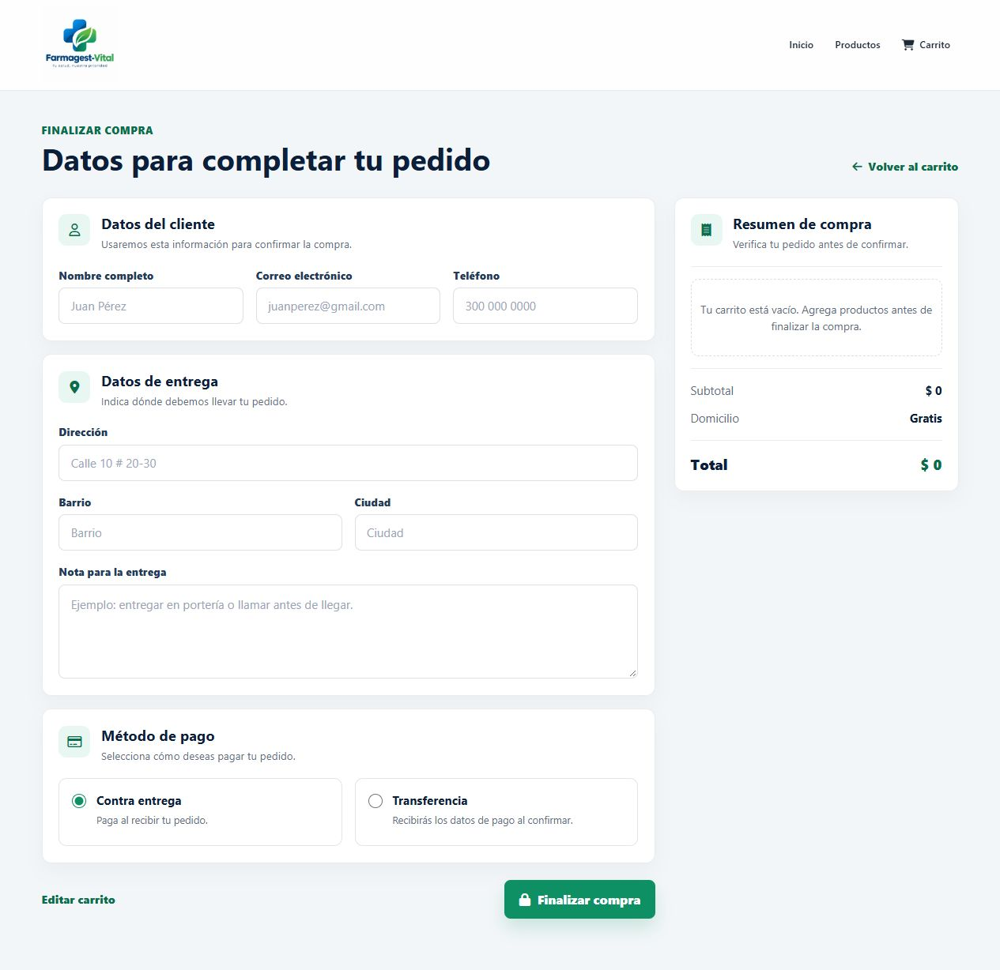
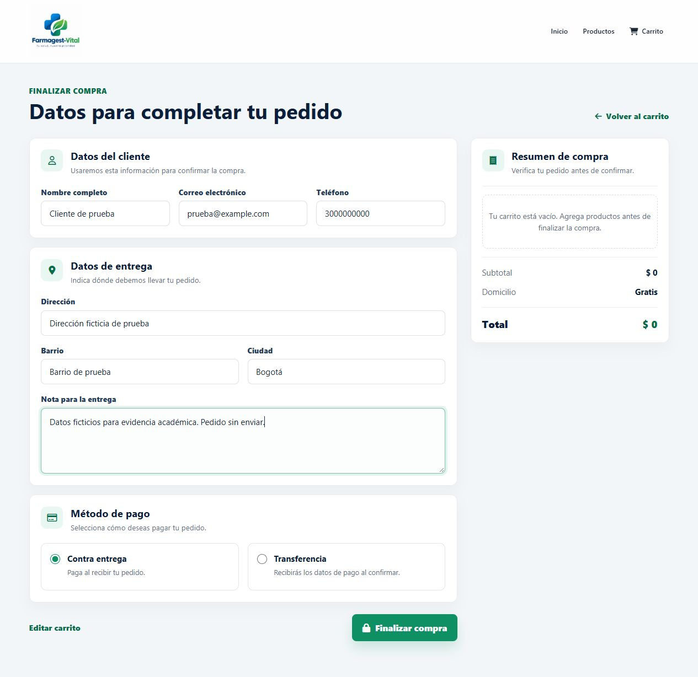
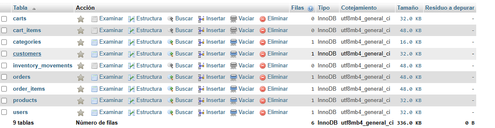
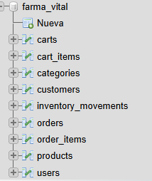

# Evidencias de formularios y base de datos

Fecha: 25 de octubre de 2026.

Las capturas de formularios se tomaron del frontend abierto en un navegador mediante un servidor local. No se modificó la interfaz para generar estas imágenes. Las dos capturas de MySQL fueron proporcionadas por el usuario.

## Formulario de acceso

Página: `frontends/dashboards/auth/login.html`.

Se comprobó la visualización de los campos de usuario y contraseña y del botón de ingreso. No se introdujeron credenciales ni se inició sesión; los textos visibles son los placeholders del formulario.

## Formulario de pedido vacío

Página: `frontends/ecommerce/formularyOfShoip.html`.

Se comprobó la visualización de datos del cliente, dirección, método de pago y resumen del carrito vacío.

## Formulario de pedido diligenciado

Se rellenaron los campos con datos ficticios: Cliente de prueba, prueba@example.com, teléfono de prueba, dirección ficticia y nota explicativa. El carrito permaneció vacío y no se pulsó Finalizar compra.

## Base de datos MySQL: tablas

Captura proporcionada por el usuario desde phpMyAdmin. Muestra nueve tablas con motor InnoDB: `carts`, `cart_items`, `categories`, `customers`, `inventory_movements`, `orders`, `order_items`, `products` y `users`.

La vista informa una fila en cada una de las tablas `categories`, `customers`, `orders`, `order_items`, `products` y `users`. Las tablas `carts`, `cart_items` e `inventory_movements` aparecen sin filas. No se muestran los valores de los registros.

## Base de datos MySQL: árbol de tablas

La segunda captura identifica la base `farma_vital` y sus nueve tablas en el panel lateral de phpMyAdmin.

## Alcance de las evidencias

Las imágenes documentan los formularios y la existencia de tablas y registros en la base mostrada. No permiten atribuir esos registros al formulario diligenciado: ese pedido no se envió. Para demostrar el flujo completo falta capturar el resultado de una prueba enviada, la consola y el contenido del registro correspondiente en MySQL.
