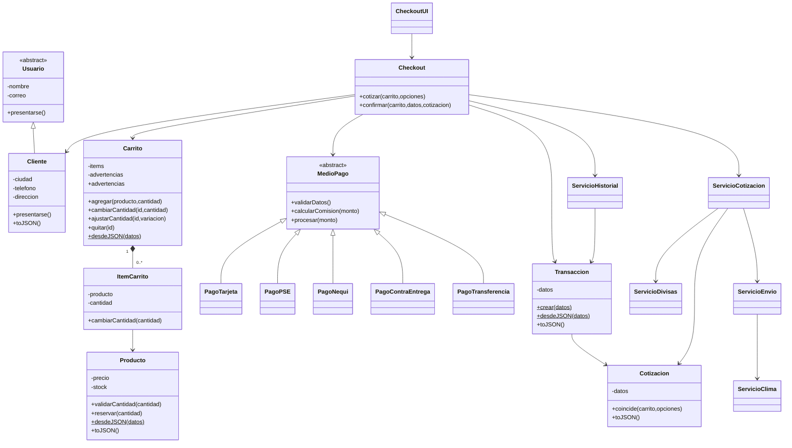

# Programación orientada a objetos en FarmaGest Vital

Adaptación académica del flujo de tienda al dominio de una farmacia. El catálogo, carrito, cotización, validación de pagos, recibo e historial utilizan clases ES con estado privado. El backend conserva la organización existente por rutas, controladores, servicios y repositorios; las reglas compartidas de cotización se reutilizan en Node.js.

## Probar el flujo completo

1. Sirve la raíz con Live Server o Apache de XAMPP. No abras los HTML mediante `file://`: los módulos ES y el catálogo JSON requieren HTTP.
2. Abre `frontends/ecommerce/products.html?modo=demo` o pulsa **Probar compra simulada** en el catálogo.
3. Agrega productos y cambia cantidades en el carrito. Los productos ficticios y reales no se pueden mezclar.
4. Ve a finalizar compra. Escribe datos ficticios, elige ciudad, moneda y medio de pago. Pulsa **Cotizar pedido**.
5. Revisa envío, comisión, moneda y origen de la tasa. Autoriza el uso de datos y completa únicamente los campos ficticios del medio elegido.
6. Pulsa **Simular compra**. Se muestra un recibo identificado como simulación, sin cobros ni pedidos al backend.
7. Recarga la página: el recibo se reconstruye desde JSON y aparece en el historial del navegador. Puedes descargarlo.

El catálogo real requiere backend y base de datos. Su checkout pide una cotización firmada a `POST /api/sales/quote`; al confirmar, `POST /api/sales/checkout` exige consentimiento y verifica firma, vigencia, destino, precios y cantidades antes de descontar stock. No se convierten automáticamente fallos del backend en pedidos simulados. Los pedidos reales quedan pendientes de pago: la validación de Tarjeta/PSE/Nequi es únicamente académica.

## Despliegue del catálogo real

Frontend y backend deben publicarse juntos: el checkout nuevo necesita los endpoints de cotización y consentimiento. El backend importa los modelos y servicios puros de `frontends/js/` para mantener una sola implementación de las reglas.

En Render, deja **Root Directory vacío** para que esté disponible todo el repositorio. Usa `pnpm --dir backends install --frozen-lockfile` como comando de instalación y `npm start` como comando de inicio desde la raíz. Conserva las variables PostgreSQL y `JWT_SECRET` existentes. No limites los filtros de despliegue a `backends/`: incluye también `frontends/js/models/` y `frontends/js/services/`. Render no permite acceder a archivos fuera de una Root Directory configurada: [documentación oficial de monorepos](https://render.com/docs/monorepo-support).

La demostración estática funciona en GitHub Pages sin backend; configura Pages para publicar desde la raíz del repositorio. El checkout real requiere la API de Render disponible. Estos cambios no modifican automáticamente la configuración remota.

## Los cuatro pilares

| Pilar | Aplicación |
| --- | --- |
| Encapsulamiento | `Producto` protege `#precio` y `#stock`. `ItemCarrito` controla su cantidad. `Carrito` conserva sus líneas en un `#items`. Los getters devuelven copias de los objetos internos. |
| Herencia | `Cliente extends Usuario`, inicializa la identidad mediante `super()` y especializa `presentarse()`. |
| Polimorfismo | `Checkout` llama a `medio.procesar(monto)` sin distinguir Tarjeta, PSE, Nequi, contra entrega o transferencia. Cada subclase valida datos y calcula su comisión. |
| Abstracción | `Usuario` y `MedioPago` rechazan instanciación directa. `MedioPago` exige implementar validación y comisión. Los servicios ocultan las APIs al dominio y al DOM. |

Los constructores validan el estado inicial. `Producto.desdeJSON()` y `Transaccion.desdeJSON()` son fábricas estáticas; `toJSON()` define los datos serializables. Los atributos de los recibos no se pueden modificar desde fuera, ni siquiera a través de una copia retornada por `toJSON()`.

## Diagrama UML de clases

## Requisitos del ejercicio

| Requisito | Implementación |
| --- | --- |
| RF-01 Cliente validado dentro de clases | `models/Usuario.js`, `models/Cliente.js`; autorización obligatoria. |
| RF-02 Objetos Producto desde JSON | `data/productos.json`, `services/ServicioCatalogo.js`, `Producto.desdeJSON()`. El catálogo real sigue usando la API y también se transforma en instancias. |
| RF-03 Carrito y stock | `models/Carrito.js`, `models/ItemCarrito.js`, `models/Producto.js`; stock confirmado nuevamente en el backend. |
| RF-04 Envío y clima | `services/ServicioEnvio.js`, `services/ServicioClima.js`; ciudad elegida, sin geolocalización precisa. |
| RF-05 COP, USD, EUR | `services/ServicioDivisas.js`, `models/Cotizacion.js`; tasa congelada en el recibo. |
| RF-06 Medios de pago | `models/pagos/`; validación y comisión diferentes mediante la misma llamada. No hay pasarela ni cobros. |
| RF-07 Transacción y recibo | `models/Transaccion.js`; UUID, fecha, estado, productos, importes y tasa utilizada. |
| RF-08 Historial local | `services/ServicioHistorial.js`; hasta 100 recibos serializados y reconstruidos con la fábrica estática. |

Las rutas de la tabla son relativas a `frontends/js/`, salvo `data/productos.json`, que está en `frontends/data/`.

## Servicios externos y respaldo

- **ExchangeRate-API**: endpoint público `https://open.er-api.com/v6/latest/USD`. [Documentación oficial](https://www.exchangerate-api.com/docs/free). [Rates By Exchange Rate API](https://www.exchangerate-api.com). El adaptador guarda en memoria COP/USD/EUR durante una hora. Si falla, usa tasas ilustrativas explícitas (1 USD = 4200 COP y 1 USD = 0,92 EUR). No se presentan como tasas vigentes.
- **Open-Meteo**: `https://api.open-meteo.com/v1/forecast`, variables actuales `precipitation` y `weather_code`. [Documentación y atribución](https://open-meteo.com/en/docs). Se consulta la ubicación pública de la ciudad elegida y se mantiene una caché de diez minutos. Si falla, no se cobra recargo ilustrativo por lluvia y se informa el respaldo.
- Cada consulta tiene un tiempo límite de seis segundos y manejo de errores. Las URLs de consulta están en clases de servicio, no en los modelos de dominio ni en la vista.

El envío académico se calcula desde Medellín con distancia en línea recta (Haversine): base 5000 COP + 35 COP/km + 2000 COP si llueve. Para subtotal de al menos 250000 COP, el envío es cero. No representa una tarifa real ni una ruta vial. Las comisiones académicas son 2,9 % para tarjeta, 1500 COP para PSE y cero para los otros medios. Se muestran antes de confirmar y se incluyen en el total del pedido.

## Privacidad y consistencia

- El formulario incluye autorización y un [aviso de privacidad](../frontends/ecommerce/privacidad.html).
- La tarjeta de prueba pide solo cuatro dígitos ficticios y vencimiento; nunca PAN completo ni CVV. Los campos de pago no se envían al backend ni se serializan en los recibos.
- El historial no guarda identidad ni datos de contacto del cliente. La base de datos conserva los datos necesarios de los pedidos reales según el flujo existente.
- Contra entrega exige confirmar que el pago queda pendiente hasta la entrega. Transferencia exige reconocer que el formulario no verifica un movimiento bancario. Ambas validaciones requieren el booleano `true`; no aceptan textos como `"true"` ni confirman cobros.
- Al reconstruir el carrito, las líneas inválidas se descartan con advertencias consultables mediante `carrito.advertencias`. La pantalla del carrito y el checkout muestran el aviso; las líneas válidas se conservan.
- El envío y la tasa de cambio se fijan en una cotización de diez minutos. Cambiar destino, moneda, método o cantidades invalida la cotización. El backend rechaza cambios de precio o stock y revierte la transacción SQL.
- Si el navegador no permite guardar el historial, se conserva el recibo en pantalla y se ofrece descargarlo. No se reenvía un pedido que ya fue confirmado por un fallo de almacenamiento local.

## Pruebas y sustentación

Ejecuta `npm test` desde la raíz para probar backend y dominio frontend; `npm run typecheck` comprueba TypeScript. Las pruebas de APIs usan respuestas controladas y fallos simulados: no requieren servicios externos ni escriben en una base real.

Verificación del 27 de octubre de 2026: 34 pruebas aprobadas (18 backend y 16 frontend), TypeScript sin errores y compra demo comprobada en navegador con historial tras recarga. [Captura y alcance de las evidencias](evidencias/README.md#compra-simulada-con-poo). El flujo contra una base MySQL/PostgreSQL real requiere una prueba de aceptación en el entorno de desarrollo; las pruebas automatizadas utilizan un doble transaccional.

Para sustentar: demuestra que no se puede escribir directamente `producto.price`, explica `Cliente extends Usuario`, recorre tres objetos `MedioPago` llamando al mismo `procesar()`, completa una compra demo, recarga el historial y muestra que la tasa del recibo no cambia.

## Créditos y decisiones

Proyecto: FarmaGest Vital, repositorio de [kleyderBackend](https://github.com/kleyderBackend/farmagest-vital). Las autorías de cada cambio se conservan en Git. Se reutiliza el frontend existente y se adapta el ejercicio al dominio de farmacia; no se atribuyen participantes ni contribuciones que no constan en el repositorio.

Decisiones: composición para carrito/líneas/productos; herencia para identidad de usuarios y medios de pago; servicios externos aislados; recibos con lista blanca de campos; catálogo demo separado y explícito; backend como autoridad de precios y stock. El autor confirmó que cuenta con aprobación docente para usar el dominio de farmacia en lugar de Coquito Amarillo.

El proyecto es una entrega individual de kleyderBackend, según confirmación del autor. El historial Git consultado contiene esa única identidad de autor. Se utilizó asistencia de Codex en implementación, revisión, documentación y pruebas.

Los subtotales por línea pertenecen a `ItemCarrito`; el ajuste de cantidades y sus límites pertenecen a `Carrito.ajustarCantidad()`. `cart-page.js` presenta esos resultados y transmite las acciones del usuario, sin calcular importes ni límites de stock.
